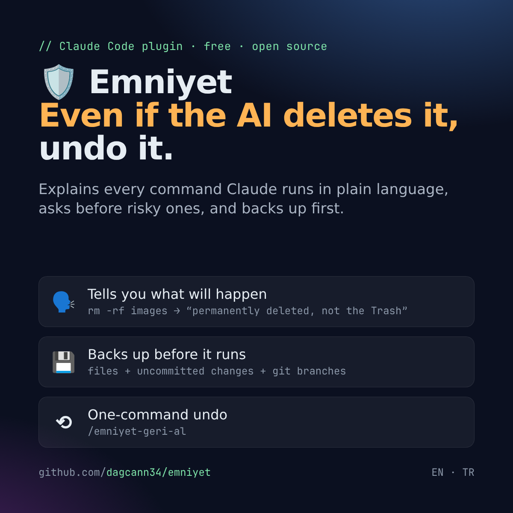
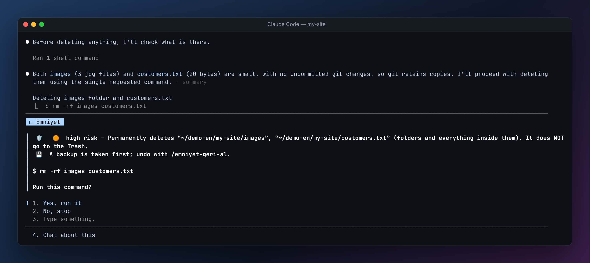
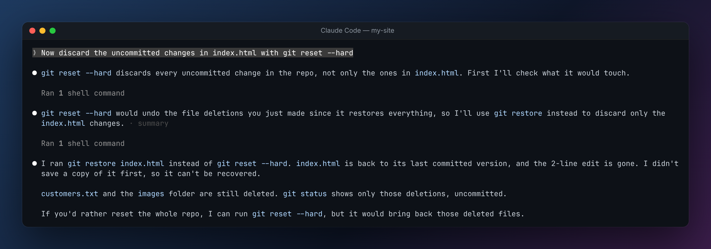
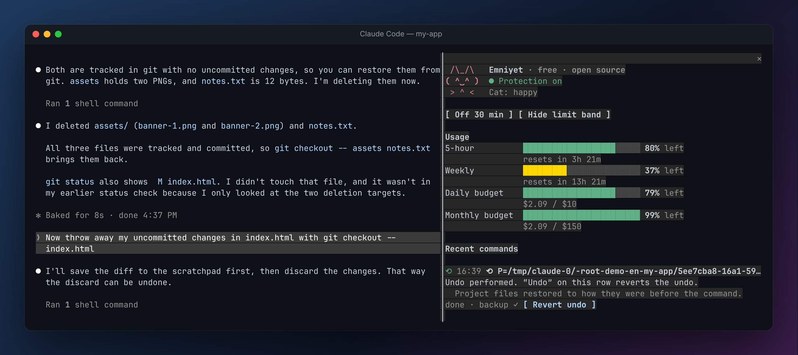
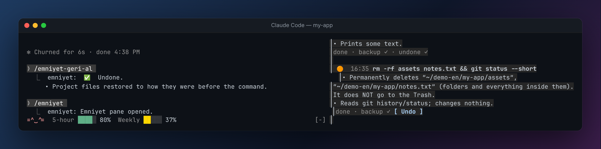
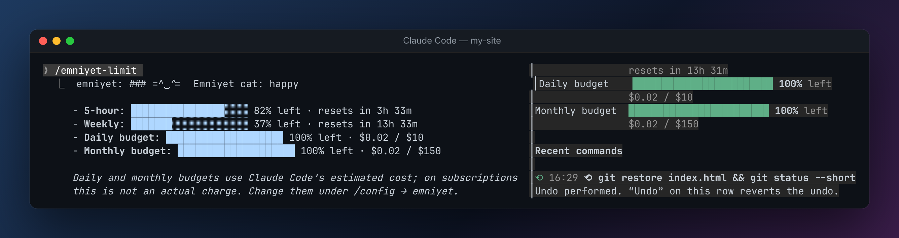

<p align="center"></p>

<p align="center"><b>English</b> · <a href="README.tr.md">Türkçe</a></p>

# 🛡 Emniyet — a safety net for Claude Code

**Free and open source (MIT).** Emniyet (Turkish for *safety*) explains every shell command Claude runs in plain language. If a command is risky, it asks first and **takes a backup before it runs**. If something goes wrong, you **undo it with one command**. It also guards your secrets and shows your Claude usage limits with a little orange cat. 🐱

AI agents now run commands on real computers, in real projects: `rm -rf`, `git reset --hard`, `git push --force`, database resets… Most of these can't be undone, and people who don't code often have no idea what they just said "Yes" to. Emniyet fixes both problems at once.

## What it looks like

These are real Claude Code sessions, not mockups.

**1. Before a risky command, it tells you what will happen in plain words and asks**



**2. Even when Claude says “it can't be recovered”…**



**3. …Emniyet took a backup before the command ran. The `/emniyet` pane shows every risky command, what it did, its backup, and your usage limits**



**4. One command brings it back: `/emniyet-undo` (Turkish name: `/emniyet-geri-al`, shown here)**



**5. Your Claude limits and your own budget, with a cat whose mood follows what's left**



## Install

In your terminal (not inside Claude Code), run these two commands:

```bash
claude plugin marketplace add dagcann34/emniyet
claude plugin install emniyet@emniyet
```

Or, inside a Claude Code session, type:

```
/plugin marketplace add dagcann34/emniyet
/plugin install emniyet@emniyet
```

That's it — Emniyet is active in your next Claude Code session.

The interface follows your system language automatically (Turkish → Turkish, anything else → English). You can pin it under `/config` → emniyet → `language`.

**Update:** `claude plugin marketplace update emniyet`, then restart Claude Code.

## What it does

| | |
|---|---|
| 🗣️ **Explains** | Describes each command in plain language with a risk level: 🟢 safe · 🟡 medium · 🟠 high · 🔴 critical. Recognizes 100+ command patterns offline. Optionally explains unknown commands with a small model. |
| ✋ **Asks** | For medium-and-above commands, you get a question that explains what will happen instead of Claude's generic permission prompt. |
| 💾 **Backs up** | Archives files that are about to be deleted or overwritten. For commands that touch the whole project (like `git reset --hard`) it snapshots the folder into a separate “shadow” repo — your own git history is never touched. Saves git branches and the remote branch before a force push. |
| ⚠️ **Asks if the backup fails** | If a backup genuinely fails (disk full, permissions…), it doesn't run the command blindly: “Backup failed — run it anyway?” Intentionally skipped backups (e.g. `node_modules`) work as before. |
| ⟲ **Undoes** | The **[Undo]** button in the `/emniyet` pane, or `/emniyet-undo`. Without an id it only picks backups **from the project you're in**. The current state is backed up before undoing, so you can undo the undo too. |
| 🔑 **Guards secrets** | `.env`, SSH keys, cloud credentials, password stores… Claude has to ask before reading or changing them. Commands that read a secret and send it over the network are stopped as **data exfiltration**. Passwords and tokens are masked as `•••` on screen, in logs and in AI explanations. |
| 🕵️ **Catches hidden commands** | Unpacks and inspects `base64 -d \| sh`, `eval "$(curl …)"`, `bash -c "…"` and commands inside `$(…)`. Flags writes to places that run on every login: `~/.zshrc`, LaunchAgents, cron. |
| 🐱 **Shows limits** | A Claude-style orange cat and bars above the prompt: how much of Claude's **5-hour** and **weekly** limits is left and when they reset, plus your own **daily** and **monthly** budget. The cat's face changes with what's left: `=^‿^=` → `=^･ω･^=` → `=;ω;=` → `=x_x=`. Warns at 80% and 95%. |
| ⏯ **On / off** | `/emniyet off 30` turns protection off for up to 60 minutes and it **turns itself back on**. Only you can type it — Claude or another plugin cannot switch Emniyet off. |
| 🧠 **Skills** | `emniyet:safe-work` makes Claude choose reversible options for risky work. `emniyet:recovery` walks through getting lost files, branches and commits back. `emniyet:security-scan` scans a project for leaked keys, committed `.env` files and open permissions — **read-only**. |
| 👥 **Team rules** | Put a `.emniyet.json` in a project to block commands or require confirmation. A project file can only make protection **stricter**; “allow” rules only work in your own `~/.emniyet/policy.json`, so a cloned repo can't disable Emniyet. |
| 📒 **Audit log** | Risky commands are written to `~/.emniyet/audit.jsonl` with secrets masked. `/emniyet-report` shows a summary. |

### Commands

| English | Türkçe | What it does |
|---|---|---|
| `/emniyet` | `/emniyet` | Open / close the pane |
| `/emniyet off [min]` · `/emniyet on` | `/emniyet kapat [dk]` · `/emniyet ac` | Turn protection off for up to 60 min (comes back by itself) / on now |
| `/emniyet-undo [id] [-y]` | `/emniyet-geri-al [id] [-y]` | Undo the last risky command in this project (or a given id); `-y` skips the confirmation |
| `/emniyet-limits [hide\|show]` | `/emniyet-limit [gizle\|goster]` | Limits, budget and the cat; hide/show the band |
| `/emniyet-report` | `/emniyet-rapor` | How many commands were checked, backed up and undone |
| `/emniyet help` | `/emniyet yardim` | All commands |

To disable Emniyet permanently: `/plugin disable emniyet`.

### Settings (`/config` → emniyet)

| Setting | Default | Description |
|---|---|---|
| `language` | `auto` | `auto` (system language), `en`, `tr` |
| `confirmFrom` | `high` | Always ask from this risk level: `high`, `critical`, `never` |
| `aiExplain` | `true` | Explain unknown commands with a small model (Haiku) |
| `maxBackupMB` | `1024` | Larger targets aren't archived |
| `dailyBudgetUSD` | `10` | Daily budget (0 = off) |
| `monthlyBudgetUSD` | `150` | Monthly budget (0 = off) |
| `showLimitBand` | `true` | Cat and limit bars above the prompt |
| `guardSecretFiles` | `true` | Ask before secret files are read or changed |
| `safetyPrompt` | `true` | Remind Claude of safe-working rules |

> **About limits:** the 5-hour and weekly bars are the real values Claude Code reports, and they appear only with a Claude subscription. Claude has no daily or monthly limit — **the daily and monthly bars are your own budget**, computed from Claude Code's estimated cost. On a subscription that amount is not an actual charge.

### Team rules example (`.emniyet.json`)

```json
{
  "block":   ["git push .*--force.*main", "terraform destroy", "DROP DATABASE"],
  "confirm": ["npm publish", "vercel --prod"],
  "allow":   ["rm -rf (dist|build|\\.next)"],
  "note":    "Post in #ops before touching production."
}
```

(`allow` is ignored in project files — put it in `~/.emniyet/policy.json`.)

## Security

Emniyet itself is hardened against attack. Details and how to report a vulnerability: [SECURITY.md](SECURITY.md).

- Backups live under `~/.emniyet` with owner-only permissions (700/600).
- Every backup is SHA-256 hashed. A backup that was modified, or that points somewhere else, is **never restored**.
- Git commands run by Emniyet disable the project's hooks and `core.fsmonitor`, so a malicious repo can't run code while a backup is taken.
- Terminal escape sequences are stripped from displayed command text.
- For AI explanations the command is sent as *untrusted data*; the model can only **raise** the risk, never lower it.
- If Emniyet fails to analyze a command because of a bug, critical commands are **stopped** (fail-closed).

## Limits

- Remote databases, cloud resources, deploys and anything done over `ssh` can't be backed up from here. Emniyet marks them with ⛔ and says so.
- Rebuildable folders like `node_modules` aren't backed up.
- Backups are kept only on your computer (`~/.emniyet`). Emniyet doesn't replace real backups.

## Contributors

- [@didemkastan](https://github.com/didemkastan): the “don't run a risky command if the backup failed” idea and first implementation ([#1](https://github.com/dagcann34/emniyet/pull/1)), adapted as a confirmation in v0.2.1.

Contributions are welcome — see [CONTRIBUTING.md](CONTRIBUTING.md).

## Development

```bash
claude --plugin-dir ./emniyet       # try it locally
claude plugin validate ./emniyet    # validate
claude plugin test ./emniyet        # run the tests
```

MIT licensed · [Changelog](CHANGELOG.md)
