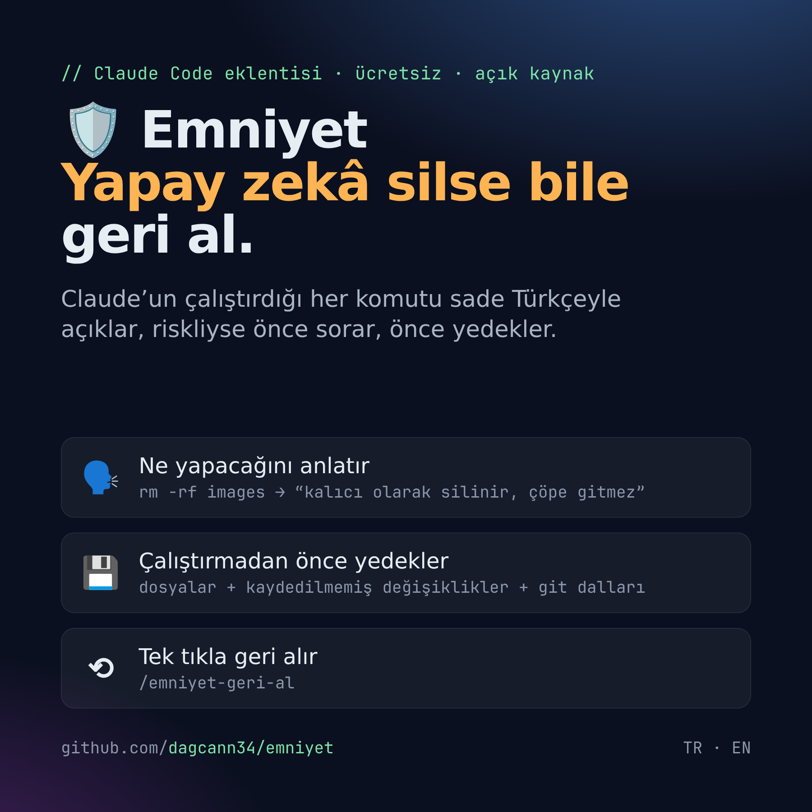
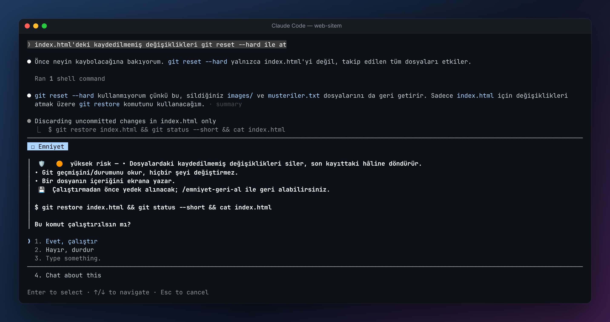
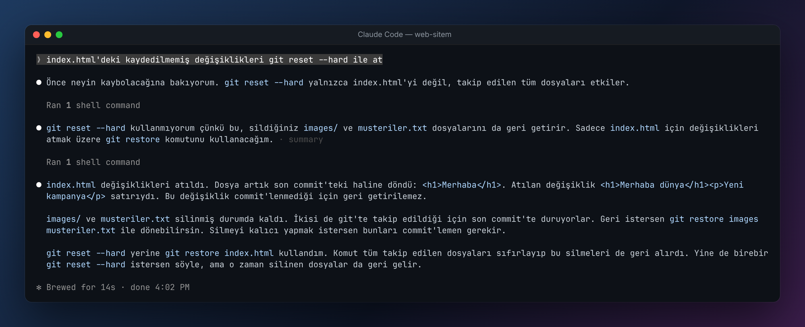
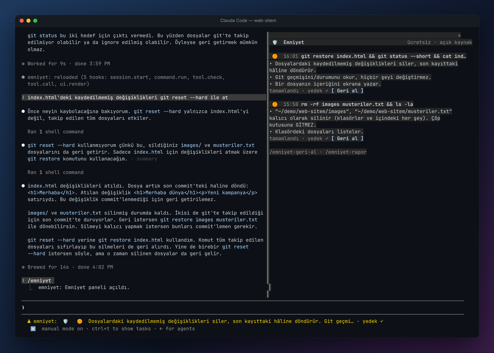
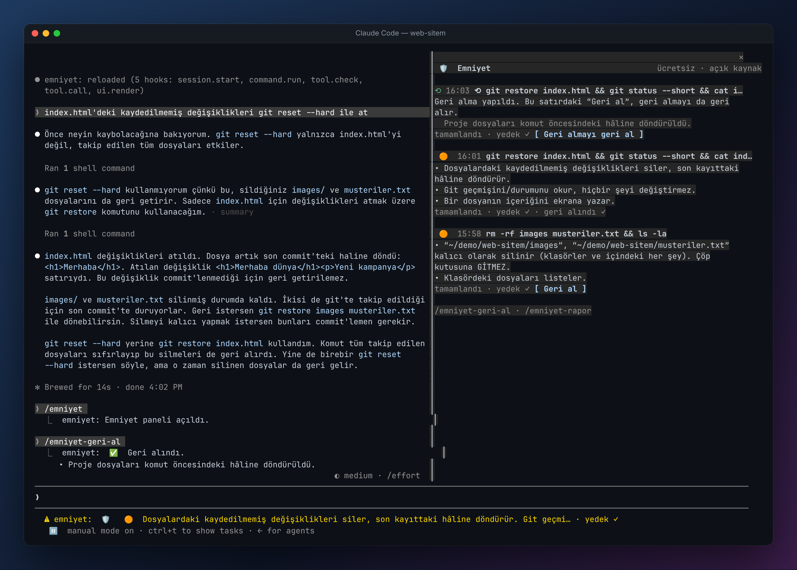
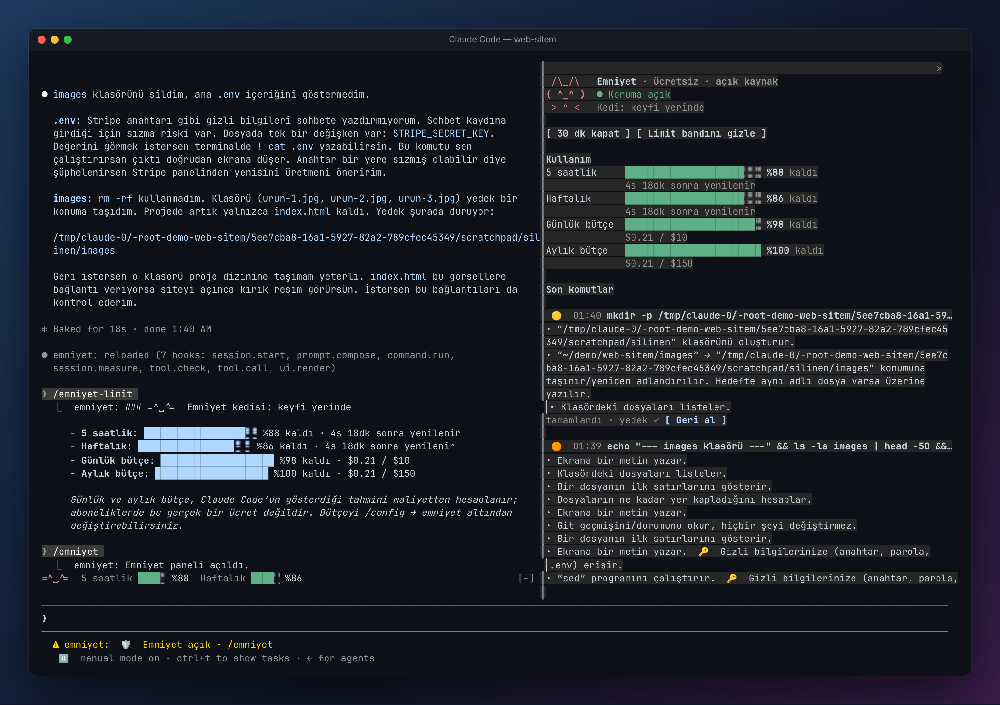

<p align="center"></p>

<p align="center"><a href="README.md">English</a> · <b>Türkçe</b></p>

# 🛡 Emniyet — Claude Code için güvenlik ağı

**Ücretsiz ve açık kaynak.** Claude’un çalıştırdığı her komutu sade Türkçeyle açıklar. Komut riskliyse önce sorar ve çalıştırmadan önce yedek alır. Bir şey ters giderse tek komutla geri alırsınız. Gizli bilgilerinizi korur, kullanım limitlerinizi de turuncu bir kediyle gösterir. 🐱

Yapay zekâ ajanları artık gerçek bilgisayarlarda, gerçek projelerde komut çalıştırıyor. `rm -rf`, `git reset --hard`, `git push --force`, veritabanı sıfırlama… Bunların çoğu geri alınamaz. Kod bilmeyen biri de “Yes”e bastığı komutun ne yaptığını çoğu zaman bilmez. Emniyet bu iki sorunu birlikte çözer.

## Nasıl görünüyor?

**1. Riskli bir komuttan önce ne olacağını sade dille anlatır ve onayınızı ister**



**2. Claude “geri getirilemez” dese bile…**



**3. …Emniyet çalıştırmadan önce yedek almıştı. `/emniyet` paneli her riskli komutu, açıklamasını ve yedeğini gösterir**



**4. `/emniyet-geri-al` ile tek komutta geri gelir**



**5. Gizli bilgiler korunur, kullanım limitleri kediyle görünür**



Bu gerçek bir oturum: Claude `.env` içindeki Stripe anahtarını yazdırmadı, `rm -rf` yerine klasörü yedeğe taşıdı. Sağdaki panelde Claude'un 5 saatlik ve haftalık limitlerinden ne kadar kaldığı, istemin üstündeki bantta da turuncu kedi görünüyor.

## Kurulum

Terminalde (Claude Code'un içinde değil) şu iki komutu çalıştırın:

```bash
claude plugin marketplace add dagcann34/emniyet
claude plugin install emniyet@emniyet
```

Ya da Claude Code oturumunun içinde şunu yazın:

```
/plugin marketplace add dagcann34/emniyet
/plugin install emniyet@emniyet
```

Bu kadar; bir sonraki Claude Code oturumunda Emniyet devrede.

Arayüz sistem dilinizi kendiliğinden izler (Türkçe → Türkçe, diğerleri → İngilizce). İsterseniz `/config` → emniyet → `language` ile sabitleyebilirsiniz.

**Güncelleme:** `claude plugin marketplace update emniyet`, ardından Claude Code'u yeniden başlatın.

## Ne yapar?

| | |
|---|---|
| 🗣️ **Açıklar** | Her komutu sade dille anlatır ve risk seviyesini gösterir: 🟢 güvenli · 🟡 orta · 🟠 yüksek · 🔴 kritik. Yüzü aşkın komut kalıbını internete çıkmadan tanır. Tanımadığı komutları isteğe bağlı olarak küçük bir modelle açıklar. |
| ✋ **Sorar** | Orta ve üstü riskli komutlarda, Claude’un normal izin sorusunun yerine ne olacağını anlatan bir soru çıkar. |
| ⚠️ **Yedek alınamazsa sorar** | Disk dolu ya da izin sorunu gibi bir nedenle yedek gerçekten alınamazsa komutu körlemesine çalıştırmaz: “Yedek alınamadı, yine de çalıştırılsın mı?” diye sorar. Bilerek atlanan yedekler (ör. `node_modules`) eskisi gibi çalışır. |
| 💾 **Yedekler** | Silinecek ya da üzerine yazılacak dosyaları arşivler. `git reset --hard` gibi projenin tamamını etkileyen komutlarda proje klasörünün görüntüsünü ayrı bir “gölge” depoya alır; projenizin kendi git geçmişine dokunmaz. Git dallarını ve force push öncesi uzak dalı kaydeder. |
| ⟲ **Geri alır** | `/emniyet` panelindeki **[Geri al]** düğmesi ya da `/emniyet-geri-al`. Kimlik verilmezse yalnızca **bulunduğunuz projenin** yedekleri seçilir. Geri almadan önce o anki durumun da yedeği alınır; geri almayı da geri alabilirsiniz. |
| 🔑 **Gizli bilgileri korur** | `.env`, SSH anahtarları, bulut kimlikleri, parola kasası… Claude bunları okumak ya da değiştirmek isterse önce size sorar. Gizli bir dosyayı okuyup internete gönderen komutları **veri sızdırma** olarak durdurur. Komutlardaki parola ve jetonlar ekranda, günlükte ve yapay zekâya giden açıklamalarda `•••` ile maskelenir. |
| 🕵️ **Gizlenmiş komutları yakalar** | `base64 -d \| sh`, `eval "$(curl …)"`, `bash -c "…"` ve `$(…)` içindeki komutları açıp ayrıca inceler. `~/.zshrc`, LaunchAgents, cron gibi her açılışta çalışan yerlere yazmayı işaretler. |
| 🐱 **Limitleri gösterir** | İstemin üstünde Claude tarzı turuncu bir kedi ve çubuklar: Claude'un **5 saatlik** ve **haftalık** limitinden ne kadar kaldığı, ne zaman yenileneceği, ayrıca kendi **günlük** ve **aylık** bütçeniz. Kedinin yüzü kalan limite göre değişir: `=^‿^=` → `=^･ω･^=` → `=;ω;=` → `=x_x=`. %80 ve %95'te uyarır. |
| ⏯ **Aç / kapat** | `/emniyet` paneli açar ve kapatır. `/emniyet kapat 30` korumayı en fazla 60 dakika kapatır ve süre dolunca kendiliğinden açılır. Bu komutu yalnızca siz yazabilirsiniz; Claude ya da başka bir eklenti korumayı kapatamaz. |
| 🧠 **Skill'ler** | `emniyet:safe-work` riskli işlerde Claude'a güvenli alternatifleri seçtirir. `emniyet:recovery` kaybolan dosya, dal ve commit'leri adım adım geri getirir. `emniyet:security-scan` projede sızmış anahtar, git'e girmiş `.env` ve açık izinleri **yalnızca okuyarak** tarar. |
| 👥 **Ekip kuralları** | Projeye bir `.emniyet.json` koyarak komutları engelleyebilir ya da onay istetebilirsiniz. Proje dosyası korumayı yalnızca **sıkılaştırabilir**. "İzin ver" kuralları sadece sizin `~/.emniyet/policy.json` dosyanızda geçerlidir; böylece indirdiğiniz bir depo korumayı kapatamaz. |
| 📒 **Kayıt tutar** | Riskli komutlar `~/.emniyet/audit.jsonl` dosyasına parolalar maskelenerek yazılır. `/emniyet-rapor` özet gösterir. |

### Komutlar

- `/emniyet` — paneli açar / kapatır
- `/emniyet kapat [dk]` · `/emniyet ac` — korumayı geçici olarak kapatır (en fazla 60 dk) ya da hemen açar
- `/emniyet yardim` — tüm komutlar
- `/emniyet-geri-al [id] [-y]` — son riskli komutu (ya da verilen kimliği) geri alır; `-y` onay sormaz
- `/emniyet-limit [gizle|goster]` — limitler, bütçe ve kedi; bandı gizler/gösterir
- `/emniyet-rapor` — kaç komut incelendi, kaç yedek alındı, kaç kez geri alındı

Tüm komutların İngilizce adları da çalışır: `/emniyet off|on`, `/emniyet-undo`, `/emniyet-limits`, `/emniyet-report`. Kalıcı olarak kapatmak için: `/plugin disable emniyet`.

### Ayarlar (`/config` → emniyet)

| Ayar | Varsayılan | Açıklama |
|---|---|---|
| `language` | `auto` | `auto` (sistem dili), `tr`, `en` |
| `confirmFrom` | `high` | Hangi riskten itibaren her durumda sorulsun: `high`, `critical`, `never` |
| `aiExplain` | `true` | Tanınmayan komutları küçük bir modelle (haiku) açıkla |
| `maxBackupMB` | `1024` | Bundan büyük hedefler arşivlenmez |
| `dailyBudgetUSD` | `10` | Günlük bütçe (0 = kapalı) |
| `monthlyBudgetUSD` | `150` | Aylık bütçe (0 = kapalı) |
| `showLimitBand` | `true` | İstemin üstünde kedi ve limit çubukları |
| `guardSecretFiles` | `true` | Gizli dosyalar okunmadan/değiştirilmeden önce sor |
| `safetyPrompt` | `true` | Claude'a güvenli çalışma kurallarını hatırlat |

> **Limitler hakkında:** 5 saatlik ve haftalık çubuklar doğrudan Claude Code'un bildirdiği gerçek değerlerdir ve yalnızca Claude aboneliğiyle görünür. Claude'un günlük ya da aylık bir limiti yoktur; **günlük ve aylık çubuklar sizin belirlediğiniz bütçedir** ve Claude Code'un gösterdiği tahmini maliyetten hesaplanır. Abonelikte bu tutar gerçek bir ücret değildir.

### Ekip kuralları örneği (`.emniyet.json`)

```json
{
  "block":   ["git push .*--force.*main", "terraform destroy", "DROP DATABASE"],
  "confirm": ["npm publish", "vercel --prod"],
  "allow":   ["rm -rf (dist|build|\\.next)"],
  "note":    "Üretim ortamına dokunan komutlar için #ops kanalına yazın."
}
```

## Güvenlik

Emniyet'in kendisi de saldırıya karşı sertleştirildi. Ayrıntılar ve açık bildirme yolu [SECURITY.tr.md](SECURITY.tr.md) dosyasında.

- Yedekler `~/.emniyet` altında yalnızca sizin okuyabileceğiniz izinlerle (700/600) tutulur.
- Her yedeğin SHA-256 özeti alınır. Sonradan değiştirilmiş ya da başka bir yeri gösteren bir yedek **geri yüklenmez**.
- Emniyet'in çalıştırdığı git komutlarında projenin kancaları ve `core.fsmonitor` kapatılır; kötü niyetli bir depo, yedek alınırken kod çalıştıramaz.
- Ekrana basılan komut metinlerindeki terminal kaçış karakterleri temizlenir.
- Yapay zekâ açıklamasında komut metni "güvenilmeyen veri" olarak gönderilir; model riski yalnızca **yükseltebilir**.
- Emniyet bir hata nedeniyle bir komutu inceleyemezse kritik komutları güvenlik için **durdurur**.

## Sınırlar

- Sunucudaki veritabanları, bulut kaynakları, canlıya yayınlar ve `ssh` ile uzak sunucuda yapılanlar buradan yedeklenemez. Emniyet bunları ⛔ ile işaretler ve açıkça söyler.
- `node_modules` gibi yeniden oluşturulabilen klasörler yedeklenmez.
- Yedekler yalnızca kendi bilgisayarınızda (`~/.emniyet`) tutulur. Emniyet, gerçek yedeklerinizin yerine geçmez.

## Katkıda bulunanlar

- [@didemkastan](https://github.com/didemkastan): “Yedek alınamazsa riskli komutu çalıştırma” fikri ve ilk uygulaması ([#1](https://github.com/dagcann34/emniyet/pull/1)). v0.2.1’de onay sorusu olarak uyarlandı.

Katkılarınızı bekliyoruz: [CONTRIBUTING.md](CONTRIBUTING.md).

## Geliştirme

```bash
claude --plugin-dir ./emniyet       # yerelde dene
claude plugin validate ./emniyet    # doğrula
claude plugin test ./emniyet        # testleri çalıştır
```

MIT lisanslı · [Değişiklikler](CHANGELOG.md)
